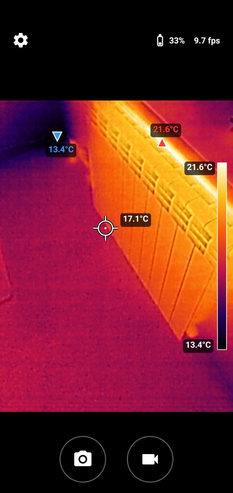
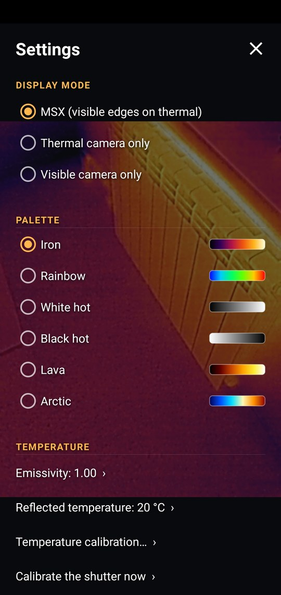
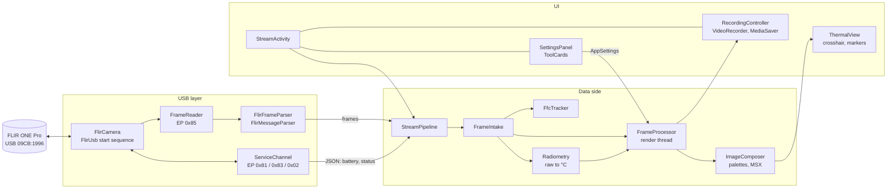

# FLIR ONE Pro for Android: an independent thermal-camera viewer

An Android app (Kotlin) that shows the live picture of a **FLIR ONE Pro** thermal camera (USB-C) and measures temperatures
with it. The camera is driven by **its own USB driver** written from scratch on top of Android's USB host API: no vendor
SDK, no native libraries.

> **Unofficial project.** This app is **not affiliated with, authorized by, or endorsed by Teledyne FLIR**. "FLIR",
> "FLIR ONE" and "Lepton" are trademarks of their owners and are used here only to name the hardware the app works with.
> The camera protocol was studied **for interoperability** with a camera owned by the author. See
> [Disclaimer](#disclaimer-and-legal) and [Credits](#credits).

<p align="center">
  
  &nbsp;&nbsp;
  
</p>

## Why

The manufacturer's app cannot be installed on the author's phone (Honor 10, Android 10: Google Play reports the device
as unsupported), so the camera was useless there. Instead of waiting for support, the USB protocol was reverse-engineered
and the app was built around it. It started as a USB diagnostic tool and grew into a complete viewer.

## Features

- **Live view** at about 9.7 frames per second: 160×120 thermal image together with the 1440×1080 visible-light picture.
- **Three display modes:** thermal only, visible only, and **MSX**: edges of the visible picture laid over the thermal one.
- **Temperatures:** a draggable crosshair, markers for the hottest and coldest point, a temperature scale, adjustable
  **emissivity** and **reflected temperature**.
- **In-app calibration:** enter one or more reference temperatures (for example from a thermocouple); the app fits the
  offset, or offset and sensitivity, and keeps them between launches.
- **Six palettes** (Iron, Rainbow, White hot, Black hot, Lava, Arctic), switched live.
- **Photo and video** saved to the gallery (`Pictures/FLIR ONE Pro`, `Movies/FLIR ONE Pro`); the video is H.264 and shows
  exactly what is on the screen, with the temperature marks.
- Screen-rotation handling, mirror, fill-the-screen mode, camera battery level, controls that can be hidden.
- English and Ukrainian interface (follows the system language, can be switched in the settings).
- Optional **manual shutter calibration** (experimental, see [Limitations](#limitations)).

## Architecture



| Part | What it does |
|---|---|
| `FlirCamera`, `FlirUsb`, `FlirReaders` | Opens the device, claims the interfaces, runs the start sequence and reads the endpoints on background threads. |
| `FlirFrameParser`, `FlirMessageParser`, `ServiceChannel` | Turn the byte stream into frames (thermal block, JPEG, JSON status) and the service endpoints into messages; independent of how USB splits the data. |
| `FrameIntake`, `FfcTracker` | Cheap per-frame work on the camera thread: decoding, following the camera's shutter calibration, skipping frames whose thermal content is invalid. |
| `Radiometry`, `TempCalibration` | The temperature model: raw sensor counts to °C, with emissivity and reflected-temperature correction and the user's calibration. No Android dependency, covered by unit tests. |
| `FrameProcessor`, `ImageComposer`, `PictureRenderer` | The render thread (only the newest frame is kept): colorizing, smooth enlargement, MSX, overlays. The same code draws the screen, photos and video, so marks always match the picture. |
| `StreamActivity` and the controllers | The screen: `StreamSession` (start/stop, USB permission), `ChromeController`, `HudController`, `RecordingController`, `SettingsPanel`, `ToolCards`. |

### How it works, in short

- **Transport.** The camera shows up as three vendor-specific interfaces. After a `SET_INTERFACE` start sequence, video
  frames arrive on bulk endpoint `0x85`; a separate JSON service channel (`0x81`, `0x83`, commands on `0x02`) carries the
  battery state, camera information and the shutter status.
- **Frame.** A frame has a 28-byte header, a thermal block (Lepton packets: 160×120 16-bit values plus telemetry), a JPEG and
  a JSON status.
- **Temperature.** The camera streams raw counts, not degrees. The app uses a Planck-type model: every time the camera
  closes its shutter (a flat-field calibration, FFC) the whole frame is uniform at a known temperature, which gives a
  reference ("anchor") for the following frames. Sensor drift is compensated with the sensor's own temperature from the
  telemetry. The model was fitted and checked against a thermocouple (see [Limitations](#limitations) for the accuracy).

## Build

Requirements: Android Studio (or a JDK 25, the version set in `gradle/gradle-daemon-jvm.properties`, with the Gradle wrapper) and Android SDK 37. The app needs Android 10 (API 29)
or newer and a device with USB host support (USB-C OTG).

```
git clone <this repository>
cd FLIRONEProApp
./gradlew assembleDebug          # app/build/outputs/apk/debug/app-debug.apk
./gradlew installDebug           # installs on a connected device
```

Plug the camera into the phone; Android offers to open the app and asks for USB permission. On Windows with a user name
in non-Latin letters see [the Gradle note](#gradle-and-a-user-name-with-non-latin-letters-windows).

## Tests

```
./gradlew testDebugUnitTest      # 111 unit tests, run on the development machine, no device needed
./gradlew lintDebug              # Android lint
./gradlew spotlessCheck detekt   # code style and code smells (see below)
```

The unit tests cover the frame and message parsers (including data split at arbitrary points), command framing,
the temperature model against measured reference values, the calibration fit, image composition, view geometry, the
shutter-calibration logic against a simulated camera, and a check that the English and Ukrainian string files match.
The USB and UI code that needs real hardware is verified on a device.

For development without the camera, debuggable builds contain a replay of recorded frames and a self-test that renders the
whole UI into PNG files; both are started from `adb` and are not reachable in the app itself.

## Limitations

- **One camera, one phone.** Developed and verified with a single FLIR ONE Pro (USB `09CB:1996`, Lepton sensor 160×120,
  sled firmware 1.0.27) on a Honor 10 (Android 10). Other FLIR ONE models and firmware versions are untested.
- **Temperature accuracy.** Not a certified instrument. Compared with a thermocouple the app agrees to about ±1 K between
  −15 and +35 °C, and up to about ±3 K in general. Hot surfaces above about 60 °C are not verified. Small objects (a few
  pixels across) read too low, and shiny metals read far too low unless the emissivity is set.
- **Manual shutter calibration is experimental.** The camera calibrates itself about every two minutes. The command that makes
  it calibrate on demand is not documented anywhere; the app searches for it on the camera, and so far it has not been found.
  The rest of the app does not depend on it.
- **Resolution.** The thermal sensor has only 160×120 pixels; the picture is enlarged smoothly, which adds no detail.
- **Not distributed.** No release signing and no store listing; build it yourself.

## Credits

The camera has no public protocol description. This project stands on the work of the community, which is gratefully
acknowledged. No source code from these projects was copied; the app's implementation is independent.

- [**fnoop/flirone-v4l2**](https://github.com/fnoop/flirone-v4l2) (GPL-2.0): the original reverse engineering of the FLIR ONE
  USB protocol (interfaces, start sequence, frame layout), which this app's driver follows in outline.
- [**fluxfilament/kelvinscope**](https://github.com/fluxfilament/kelvinscope) (GPL-3.0-or-later): an open-source Android viewer
  for the USB-C FLIR ONE, consulted for the meaning of the status fields.
- [**Miso98/hw-flir-one-gen3**](https://github.com/Miso98/hw-flir-one-gen3): work on running the Gen 3 camera on Linux; a
  related effort in the same community, listed here as further reading.

Everything else (the parsers, the temperature model and its fitting, the calibration, the app) was verified on the author's
own camera.

## Disclaimer and legal

- **Unofficial and unaffiliated.** This is an independent hobby and portfolio project. It is not affiliated with, authorized
  by, maintained by, sponsored by or endorsed by **Teledyne FLIR LLC** or any of its companies. **FLIR**, **FLIR ONE** and
  **Lepton** are trademarks or registered trademarks of Teledyne FLIR LLC. They are used only to identify the compatible
  hardware (nominative use) and imply no endorsement. The icon is the author's own artwork; no FLIR logo or artwork is used.
- **Protocol research for interoperability.** The USB protocol was determined by observing the behavior of a camera that
  the author owns, and by reading publicly available community research, only to make that camera work with a device the
  manufacturer's app does not support. The app contains **no FLIR SDK, firmware, binaries or documentation**, does not
  circumvent any protection, and **writes nothing to the camera's firmware or persistent settings**.
- **Not a measuring instrument.** Temperatures are approximate and must not be used for safety-critical decisions.

## License

Copyright (c) 2026 ExcitedDev.

The source code is available under the [PolyForm Noncommercial License 1.0.0](LICENSE)
(SPDX: `PolyForm-Noncommercial-1.0.0`). In short:

- You may use, study, change and share the code for **noncommercial purposes**: personal use, hobby projects, research,
  education, and use by charities, schools, public research, public safety or health bodies, and governments.
- You may **not** use it for commercial purposes, for example to sell it, to include it in a paid product or service, or
  to use it for the profit of a company.
- If you share the code, you must include the `LICENSE` file (with its `Required Notice:` line).

This is a source-available license, not an open-source license as defined by the OSI. The summary above is only a
help; the text in [LICENSE](LICENSE) is what counts.

### Third-party software

The app uses AndroidX and Material Components (Apache License 2.0) as Gradle dependencies; they are not part of this
repository and keep their own licenses. A build of the app that contains them must follow the terms of those licenses.

### No warranty

The software comes as is, without any warranty.

## Code quality checks

Two linters check the Kotlin code:

| Tool | What it checks | Check | Fix automatically |
|---|---|---|---|
| ktlint (through Spotless) | code style and formatting | `./gradlew spotlessCheck` | `./gradlew spotlessApply` |
| detekt | code smells: complexity, long methods, magic numbers, ... | `./gradlew detekt` | (by hand) |

Both must report no problems before code is committed. The detekt settings are in `config/detekt/detekt.yml`.
The unit tests run with `./gradlew testDebugUnitTest`; they are not part of the commit check.

### Git hooks

The repository has a `pre-commit` hook in the `.githooks` folder. Before every `git commit` it runs ktlint and detekt
(not the tests), and cancels the commit if they find problems. Only clean code gets into the history.

The hook checks only what is staged, that is, exactly what would be committed. It exports the staged version of the project
into a temporary folder inside `.git` and runs the linters there. Changes that are not staged, and files that are not
added, are ignored. If a commit contains no Kotlin code (`.kt`, `.kts`) and no linter settings, the check is skipped.

**Git does not run these hooks by itself.** The setting that turns them on is not stored in the repository, so every
clone needs it once. After cloning the repository, run this in its root folder:

```
git config core.hooksPath .githooks
```

On Linux and macOS the hook file must also be executable:

```
chmod +x .githooks/pre-commit
```

To check that it is on, `git config --get core.hooksPath` must print `.githooks`.

What to do when a commit is cancelled:

- If the problem is formatting, run `./gradlew spotlessApply`, look at what it changed, stage the files again and commit again.
- If detekt reports a problem, fix it in the code, stage it again and commit again.

Because the staged state is checked, every commit must be clean on its own, not only the last one of a series.

The check takes from several seconds to about a minute. It cannot be relied on alone: `git commit --no-verify` skips it, and the setting above
is local to each clone.

### Gradle and a user name with non-Latin letters (Windows)

Gradle fails if the path to the user profile contains non-Latin letters. Create a folder with an ASCII-only path, for
example `C:\gradle-ascii`, and set the environment variable `GRADLE_USER_HOME` to it. The hook uses `C:/gradle-ascii`
automatically if that folder exists and the variable is not set.
